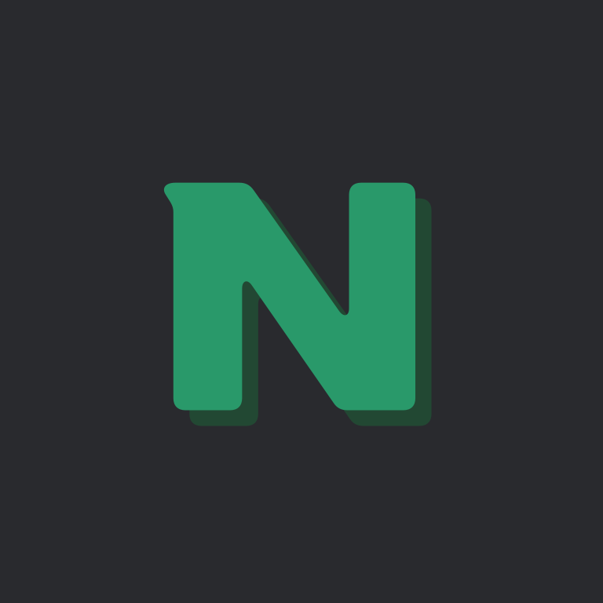

<picture>
  <source media="(prefers-color-scheme: dark)" srcset="sNSON-logo.svg">
  
</picture>


# NSON (NeonScript Object Notation)
```c
// This is a comment
"NSON" = "NeonScript Object Notation"; "version"="1.0";
  "windows.text"="Hello World!"; "windows.w"=800;  "windows.h"=600;
  "button.text"="Run!"; "button.x"=500; "button.y"=500;
```

```c
"text" = "hello";
"text2" = "hello";
"text3" = "hello";
"text4" = "512";
"text5" = "12.5";
```
语法支持字符串


支持整型、浮点型、正负数以及科学计数法表示的数字、布尔、字符串

## 未来支持的计划
- 统一化文件读写多平台统一加载 
  - [一个文件，一个启动类型，运行一个图形界面]
- 并发，异步
  - 加速启动速度，优化流畅度
